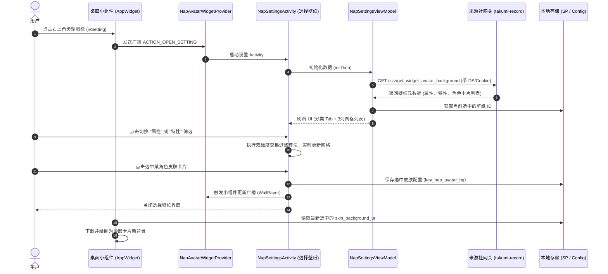

# 绝区零桌面小组件「更换皮肤 / 选择壁纸」逆向与复刻规范

本文档针对米游社 App 内绝区零（NAP/ZZZ）桌面小组件的**皮肤 / 壁纸切换功能**（点击小组件右上角设置齿轮进入“选择壁纸”界面）进行完整全链路逆向解析，涵盖**触发入口、网络接口规范、UI 布局组件、双维度过滤联动算法、本地持久化以及 Windows 端复刻实现指南**。

---

## 目录
1. [整体架构与交互时序](#一-整体架构与交互时序)
2. [触发入口与广播响应](#二-触发入口与广播响应)
3. [后端 API 接口协议规范](#三-后端-api-接口协议规范)
4. [UI 布局结构与视觉资源](#四-ui-布局结构与视觉资源)
5. [客户端业务逻辑与状态过滤](#五-客户端业务逻辑与状态过滤)
6. [Windows 端复刻落地指南与示例代码](#六-windows-端复刻落地指南与示例代码)
7. [提取源码与资源文件索引](#七-提取源码与资源文件索引)

---

## 一、 整体架构与交互时序



---

## 二、 触发入口与广播响应

### 1. 小组件界面定义
在小组件布局 [`layout_widget_nap_avatar_v2.xml`](file:///x:/AI%20project/解包/extracted_zzz_widget/04_ui_and_assets/decoded_layouts/layout_widget_nap_avatar_v2.xml) 中，右上角操作区定义了齿轮设置按钮：

```xml
<FrameLayout
    android:id="@+id/settingGroup"
    android:layout_width="wrap_content"
    android:layout_height="match_parent"
    android:paddingEnd="12dp">
    <ImageView
        android:id="@+id/ivSetting"
        android:background="@drawable/bg_nap_avatar_top_btn"
        android:layout_width="18dp"
        android:layout_height="16dp"
        android:src="@drawable/ic_nap_avatar_mini_widget_settings"/>
</FrameLayout>
```

### 2. 点击事件绑定
在 [`NapAvatarWidgetWorker.java`](file:///x:/AI%20project/解包/extracted_zzz_widget/03_business_logic/NapAvatarWidgetWorker.java) 中，为 `ivSetting` 设置了 `PendingIntent`：
```java
Intent intent = new Intent(context, NapAvatarWidgetProvider.class);
intent.setAction("com.mihoyo.hyperion.nap.miniwidget.settings.action");
remoteViews.setOnClickPendingIntent(R.id.ivSetting, PendingIntent.getBroadcast(context, 0, intent, PendingIntent.FLAG_UPDATE_CURRENT | PendingIntent.FLAG_IMMUTABLE));
```

### 3. 广播分发处理
在 [`NapAvatarWidgetProvider.java`](file:///x:/AI%20project/解包/extracted_zzz_widget/03_business_logic/NapAvatarWidgetProvider.java) 中拦截该 Action 并拉起配置页面：
```java
case 1579074796: // hash of "com.mihoyo.hyperion.nap.miniwidget.settings.action"
    if (action.equals(C0774d.g)) {
        a.b(b, "Setting", true, null, 4, null);
        NapSettingsActivity.g.a(context); // 启动 NapSettingsActivity
        return true;
    }
    break;
```

---

## 三、 后端 API 接口协议规范

### 1. 基本信息
* **接口路径**：`GET /event/game_record_zzz/api/zzz/get_widget_avatar_background`
* **完整 URL**：`https://api-takumi-record.mihoyo.com/event/game_record_zzz/api/zzz/get_widget_avatar_background`
* **Retrofit 定义文件**：[`ZzzAvatarWidgetRetrofitApi.java`](file:///x:/AI%20project/解包/extracted_zzz_widget/01_api_and_network/ZzzAvatarWidgetRetrofitApi.java)

### 2. 请求 Headers 要求
| 请求头 (Header) | 示例值 | 说明 |
| :--- | :--- | :--- |
| `DS` | `1729329600,a1b2c3,d4e5f6...` | 米游社动态密钥 (v2 算法，可参考 `DynamicSecret_DS.py`) |
| `Cookie` | `account_id=...; ltuid_v2=...; ltoken_v2=...` | 用户登录鉴权凭证 |
| `x-rpc-client_type` | `2` | 客户端类型：2 代表 Android 客户端 |
| `x-rpc-app_version` | `2.78.1` | 米游社当前版本号 |
| `x-rpc-channel` | `miyousheluodi` | 渠道标识 |
| `x-rpc-device_id` | `UUID / 64位十六进制` | 设备唯一标识符 |
| `x-rpc-device_model` | `23116PN5BC` | 设备型号 |
| `User-Agent` | `Mozilla/5.0 ... miHoYoBBS/2.78.1` | 客户端 User-Agent |

### 3. 响应报文结构 (JSON)
返回数据模型由 [`AvatarBackground.java`](file:///x:/AI%20project/解包/extracted_zzz_widget/02_data_models/AvatarBackground.java) 解析：

```json
{
  "retcode": 0,
  "message": "OK",
  "data": {
    "element_type_list": [
      {
        "id": "201",
        "icon_url": "https://upload-bbs.mihoyo.com/game_record/zzz/element_physical.png",
        "select_icon_url": "https://upload-bbs.mihoyo.com/game_record/zzz/element_physical_sel.png"
      },
      {
        "id": "202",
        "icon_url": "https://upload-bbs.mihoyo.com/game_record/zzz/element_fire.png",
        "select_icon_url": "https://upload-bbs.mihoyo.com/game_record/zzz/element_fire_sel.png"
      }
    ],
    "avatar_profession_list": [
      {
        "id": "101",
        "icon_url": "https://upload-bbs.mihoyo.com/game_record/zzz/profession_slash.png",
        "select_icon_url": "https://upload-bbs.mihoyo.com/game_record/zzz/profession_slash_sel.png"
      },
      {
        "id": "102",
        "icon_url": "https://upload-bbs.mihoyo.com/game_record/zzz/profession_strike.png",
        "select_icon_url": "https://upload-bbs.mihoyo.com/game_record/zzz/profession_strike_sel.png"
      }
    ],
    "avatar_skin_list_v2": [
      {
        "avatar_id": "1011",
        "avatar_profession": "101",
        "element_type": "204",
        "skin_id": "101101",
        "skin_name": "安比·街头迅影",
        "skin_background_url": "https://upload-bbs.mihoyo.com/game_record/zzz/skin_bg_anbi_01.png",
        "color": "#9BD824"
      },
      {
        "avatar_id": "1021",
        "avatar_profession": "104",
        "element_type": "205",
        "skin_id": "102101",
        "skin_name": "妮可·一点点俏皮",
        "skin_background_url": "https://upload-bbs.mihoyo.com/game_record/zzz/skin_bg_nicole_01.png",
        "color": "#F385B2"
      }
    ]
  }
}
```

### 4. 字段详细定义
* `element_type_list`（属性筛选列表）：
  * 对应游戏内的：**物理 (201)、火 (202)、冰 (203)、电 (204)、以太 (205)**。
  * `id`: 属性唯一 ID。
  * `icon_url`: 未选中状态图标。
  * `select_icon_url`: 选中高亮状态图标。
* `avatar_profession_list`（特性筛选列表）：
  * 对应游戏内的：**强攻 (101)、击破 (102)、异常 (103)、支援 (104)、防护 (105)**。
* `avatar_skin_list_v2`（壁纸/皮肤主体列表）：
  * `skin_id`: 皮肤唯一标识符。
  * `skin_name`: 皮肤中文展示名称（如“安比·街头迅影”）。
  * `skin_background_url`: 小组件顶部卡片的横版透底/背景大图。
  * `color`: 角色/皮肤主色调（HEX，例如 `#9BD824`），用于 UI 局部强调色或边框。

---

## 四、 UI 布局结构与视觉资源

### 1. 视图层级结构
```
NapSettingsActivity (背景色: #2a2c2b)
 ├── navigationBar (标题栏)
 │    ├── backView (返回按钮，图标: icon_widget_nap_settings_back)
 │    └── TextView ("选择壁纸", 文字颜色: #f0f0f0, 16sp, 居中)
 ├── elementView (属性筛选 Tab 栏: NapSettingTabView)
 ├── professionView (特性筛选 Tab 栏: NapSettingTabView)
 └── detailView (RecyclerView, 3列网格 GridLayoutManager)
      └── Item: layout_widget_nap_avatar_settings_item
           ├── bgView (圆角外框 8dp, 背景色: #333534)
           │    ├── avatarView (角色立绘裁剪展示 109:64)
           │    └── nameView (角色/皮肤名称，12sp, #d9dbdd)
           └── selectIcon (右上角选中对勾角标: ic_widget_nap_setting_item_selected)
```

### 2. 关键布局与文件对照表
| UI 部件 | 文件路径 | 关键配置 / 属性 |
| :--- | :--- | :--- |
| **主页面布局** | [`layout_widget_nap_avatar_settings.xml`](file:///x:/AI%20project/解包/extracted_zzz_widget/04_ui_and_assets/decoded_layouts/layout_widget_nap_avatar_settings.xml) | 主背景 `#2a2c2b`，网格背景 `#1d1f1e` |
| **卡片单元项** | [`layout_widget_nap_avatar_settings_item.xml`](file:///x:/AI%20project/解包/extracted_zzz_widget/04_ui_and_assets/decoded_layouts/layout_widget_nap_avatar_settings_item.xml) | 比例宽高比 109:84，圆角裁剪 |
| **筛选 Tab 容器** | [`layout_widget_nap_avatar_settings_tab_view.xml`](file:///x:/AI%20project/解包/extracted_zzz_widget/04_ui_and_assets/decoded_layouts/layout_widget_nap_avatar_settings_tab_view.xml) | 水平滑动容器 |
| **单个 Tab 按钮** | [`layout_widget_nap_avatar_settings_tab_item_view.xml`](file:///x:/AI%20project/解包/extracted_zzz_widget/04_ui_and_assets/decoded_layouts/layout_widget_nap_avatar_settings_tab_item_view.xml) | 图标尺寸 28dp，支持 selected 切换 |

### 3. 本地图标图片资源
* **返回图标**：[`icon_widget_nap_settings_back.png`](file:///x:/AI%20project/解包/extracted_zzz_widget/04_ui_and_assets/images/icon_widget_nap_settings_back.png)
* **选中对勾**：[`ic_widget_nap_setting_item_selected.png`](file:///x:/AI%20project/解包/extracted_zzz_widget/04_ui_and_assets/images/ic_widget_nap_setting_item_selected.png)
* **空状态图**：[`icon_widget_nap_settings_empty.png`](file:///x:/AI%20project/解包/extracted_zzz_widget/04_ui_and_assets/images/icon_widget_nap_settings_empty.png)
* **加载失败**：[`icon_widget_nap_settings_error.png`](file:///x:/AI%20project/解包/extracted_zzz_widget/04_ui_and_assets/images/icon_widget_nap_settings_error.png)

---

## 五、 客户端业务逻辑与状态过滤

### 1. 数据过滤算法（双条件交集）
源码见 [`NapSettingsActivity.java#L385-L415`](file:///x:/AI%20project/解包/extracted_zzz_widget/03_business_logic/decompiled_java/NapSettingsActivity.java#L385-L415)：
```kotlin
fun filterSkins() {
    val selectedElementId = currentElementType?.id
    val selectedProfessionId = currentProfession?.id

    if (selectedElementId == null && selectedProfessionId == null) {
        // 无筛选条件，显示全部角色卡片
        adapter.submitList(allSkins)
    } else {
        // 双条件交集过滤
        val filtered = allSkins.filter { skin ->
            val matchElement = (selectedElementId == null || skin.elementType == selectedElementId)
            val matchProfession = (selectedProfessionId == null || skin.avatarProfession == selectedProfessionId)
            matchElement && matchProfession
        }
        adapter.submitList(filtered)
    }
    // 空状态提示判断
    emptyView.visibility = if (adapter.itemCount == 0) View.VISIBLE else View.GONE
    recyclerView.scrollToPosition(0)
}
```

### 2. 选中壁纸与持久化存储
源码见 [`NapAvatarBgStorage.java`](file:///x:/AI%20project/解包/extracted_zzz_widget/03_business_logic/decompiled_java/NapAvatarBgStorage.java)：
* **存储实体**：`AvatarBackground.a` 对象的完整 JSON 序列化字符串。
* **SharedPreferences 文件名**：`SP_WIDGET_NAP_AVATAR_BG`。
* **存储键名**：`key_nap_avatar_bg`。
* **核心代码**：
  ```java
  public final void saveSelectedSkin(AvatarBackground.a skinInfo) {
      String json = GsonUtil.toJson(skinInfo);
      SharedPreferences sp = context.getSharedPreferences("sp_widget_nap_avatar_bg", Context.MODE_PRIVATE);
      sp.edit().putString("key_nap_avatar_bg", json).apply();
  }
  ```

### 3. 小组件更新链路
1. 界面被点击选择后，执行：
   ```java
   NapAvatarWidgetProvider.b.a("WallPaper", false, aVar.d()); // 统计/埋点
   NapAvatarBgStorage.a.d(aVar); // 写入 SharedPreferences
   finish(); // 立即关闭选择页返回桌面
   ```
2. 小组件接收到数据更新触发（或 15 分钟定时轮询 `NapAvatarWidgetWorker` 执行时）：
   * 通过 `NapAvatarBgStorage.a.c()` 读取已保存的 `AvatarBackground.a`；
   * 提取其中的 `skin_background_url`；
   * 通过 Glide / `NapImageManager` 将图片下载并生成 Bitmap；
   * 写入 RemoteViews 的 `ivAvatar` / `bg_widget_nap_top_avatar` 完成壁纸换肤。

---

## 六、 Windows 端复刻落地指南与示例代码

在 Windows 端复刻该功能时，可抽象为：
1. **网络层**：请求 `get_widget_avatar_background` 接口拉取全量皮肤数据；
2. **配置持久化**：使用本地 `config.json` 替代 Android 的 `SharedPreferences`；
3. **UI 弹窗**：在主窗口右上角放置齿轮按钮，点击弹出一个“选择壁纸”模态子窗口。

### Python 独立实现参考代码

```python
import json
import os
import requests
import tkinter as tk
from tkinter import ttk
from dataclasses import dataclass
from typing import List, Optional

CONFIG_FILE = "widget_config.json"
API_URL = "https://api-takumi-record.mihoyo.com/event/game_record_zzz/api/zzz/get_widget_avatar_background"

@dataclass
class SkinItem:
    avatar_id: str
    skin_id: str
    skin_name: str
    avatar_profession: str
    element_type: str
    skin_background_url: str
    color: str

class ZzzSkinManager:
    """管理皮肤接口数据与本地持久化"""
    def __init__(self, headers: dict):
        self.headers = headers
        self.all_skins: List[SkinItem] = []
        self.elements = []
        self.professions = []

    def fetch_skins(self) -> bool:
        try:
            resp = requests.get(API_URL, headers=self.headers, timeout=10)
            data = resp.json()
            if data.get("retcode") == 0:
                res = data["data"]
                self.elements = res.get("element_type_list", [])
                self.professions = res.get("avatar_profession_list", [])
                self.all_skins = [
                    SkinItem(
                        avatar_id=item["avatar_id"],
                        skin_id=item["skin_id"],
                        skin_name=item["skin_name"],
                        avatar_profession=item["avatar_profession"],
                        element_type=item["element_type"],
                        skin_background_url=item["skin_background_url"],
                        color=item.get("color", "#FFFFFF")
                    )
                    for item in res.get("avatar_skin_list_v2", [])
                ]
                return True
        except Exception as e:
            print(f"[Error] 获取壁纸列表失败: {e}")
        return False

    def get_saved_skin(self) -> Optional[dict]:
        if os.path.exists(CONFIG_FILE):
            with open(CONFIG_FILE, "r", encoding="utf-8") as f:
                return json.load(f).get("selected_skin")
        return None

    def save_skin(self, skin: SkinItem):
        data = {}
        if os.path.exists(CONFIG_FILE):
            with open(CONFIG_FILE, "r", encoding="utf-8") as f:
                data = json.load(f)
        data["selected_skin"] = skin.__dict__
        with open(CONFIG_FILE, "w", encoding="utf-8") as f:
            json.dump(data, f, ensure_ascii=False, indent=2)
        print(f"[Success] 已保存新壁纸: {skin.skin_name}")

class WallpaperSelectDialog(tk.Toplevel):
    """'选择壁纸' 独立子窗口"""
    def __init__(self, parent, manager: ZzzSkinManager, on_selected_callback):
        super().__init__(parent)
        self.title("选择壁纸")
        self.geometry("540x680")
        self.configure(bg="#2A2C2B")
        self.manager = manager
        self.on_selected_callback = on_selected_callback

        self.selected_element: Optional[str] = None
        self.selected_profession: Optional[str] = None

        self._build_ui()
        self._refresh_list()

    def _build_ui(self):
        # 顶部标题栏
        lbl_title = tk.Label(self, text="选择壁纸", font=("Microsoft YaHei", 12, "bold"), fg="#D9DBDD", bg="#2A2C2B")
        lbl_title.pack(pady=10)

        # 属性筛选条
        self.elem_frame = tk.Frame(self, bg="#2A2C2B")
        self.elem_frame.pack(fill="x", padx=15, pady=4)
        tk.Label(self.elem_frame, text="属性:", fg="#888888", bg="#2A2C2B", font=("Microsoft YaHei", 9)).pack(side="left", padx=4)
        for elem in self.manager.elements:
            btn = tk.Button(self.elem_frame, text=elem.get("id"), bg="#333534", fg="#FFFFFF", relief="flat",
                            command=lambda eid=elem.get("id"): self._toggle_element(eid))
            btn.pack(side="left", padx=3)

        # 特性筛选条
        self.prof_frame = tk.Frame(self, bg="#2A2C2B")
        self.prof_frame.pack(fill="x", padx=15, pady=4)
        tk.Label(self.prof_frame, text="特性:", fg="#888888", bg="#2A2C2B", font=("Microsoft YaHei", 9)).pack(side="left", padx=4)
        for prof in self.manager.professions:
            btn = tk.Button(self.prof_frame, text=prof.get("id"), bg="#333534", fg="#FFFFFF", relief="flat",
                            command=lambda pid=prof.get("id"): self._toggle_profession(pid))
            btn.pack(side="left", padx=3)

        # 壁纸卡片列表容器 (带滚动条)
        self.list_container = tk.Frame(self, bg="#1D1F1E")
        self.list_container.pack(fill="both", expand=True, padx=15, pady=10)

    def _toggle_element(self, eid: str):
        self.selected_element = None if self.selected_element == eid else eid
        self._refresh_list()

    def _toggle_profession(self, pid: str):
        self.selected_profession = None if self.selected_profession == pid else pid
        self._refresh_list()

    def _refresh_list(self):
        # 清理旧子项
        for child in self.list_container.winfo_children():
            child.destroy()

        # 双维度交集过滤
        filtered = [
            skin for skin in self.manager.all_skins
            if (self.selected_element is None or skin.element_type == self.selected_element) and
               (self.selected_profession is None or skin.avatar_profession == self.selected_profession)
        ]

        # 渲染 3 列网格卡片
        col_count = 3
        for idx, skin in enumerate(filtered):
            r, c = divmod(idx, col_count)
            card = tk.Frame(self.list_container, bg="#333534", bd=1, relief="ridge", width=150, height=110)
            card.grid(row=r, column=c, padx=6, pady=6, sticky="nsew")
            card.pack_propagate(False)

            lbl_name = tk.Label(card, text=skin.skin_name, fg="#D9DBDD", bg="#333534", font=("Microsoft YaHei", 9))
            lbl_name.pack(expand=True)

            # 点击选择
            card.bind("<Button-1>", lambda e, s=skin: self._select_skin(s))
            lbl_name.bind("<Button-1>", lambda e, s=skin: self._select_skin(s))

    def _select_skin(self, skin: SkinItem):
        self.manager.save_skin(skin)
        if self.on_selected_callback:
            self.on_selected_callback(skin)
        self.destroy()
```

---

## 七、 提取源码与资源文件索引

所有相关文件均可在工作区中直接点击查看：

| 模块分类 | 文件路径与链接 | 说明 |
| :--- | :--- | :--- |
| **API 接口定义** | [`ZzzAvatarWidgetRetrofitApi.java`](file:///x:/AI%20project/解包/extracted_zzz_widget/01_api_and_network/ZzzAvatarWidgetRetrofitApi.java) | Retrofit 接口声明，包含 `get_widget_avatar_background` |
| **数据模型** | [`AvatarBackground.java`](file:///x:/AI%20project/解包/extracted_zzz_widget/02_data_models/AvatarBackground.java) | 完整的 GSON 数据解析类定义 |
| **页面 Activity** | [`NapSettingsActivity.java`](file:///x:/AI%20project/解包/extracted_zzz_widget/03_business_logic/decompiled_java/NapSettingsActivity.java) | “选择壁纸”界面生命周期与视图控制 |
| **页面 ViewModel** | [`NapSettingsViewModel.java`](file:///x:/AI%20project/解包/extracted_zzz_widget/03_business_logic/decompiled_java/NapSettingsViewModel.java) | 网络请求发起、状态机及数据绑定 |
| **本地持久化** | [`NapAvatarBgStorage.java`](file:///x:/AI%20project/解包/extracted_zzz_widget/03_business_logic/decompiled_java/NapAvatarBgStorage.java) | 壁纸本地 SharedPreferences 读写逻辑 |
| **自定义 Tab 栏** | [`NapSettingTabView.java`](file:///x:/AI%20project/解包/extracted_zzz_widget/03_business_logic/decompiled_java/NapSettingTabView.java) | 属性/特性分类滑动栏 |
| **主页面布局** | [`layout_widget_nap_avatar_settings.xml`](file:///x:/AI%20project/解包/extracted_zzz_widget/04_ui_and_assets/decoded_layouts/layout_widget_nap_avatar_settings.xml) | 图二界面的主 XML 布局文件 |
| **网格卡片布局** | [`layout_widget_nap_avatar_settings_item.xml`](file:///x:/AI%20project/解包/extracted_zzz_widget/04_ui_and_assets/decoded_layouts/layout_widget_nap_avatar_settings_item.xml) | 单张角色皮肤卡片布局 |
| **小组件主布局** | [`layout_widget_nap_avatar_v2.xml`](file:///x:/AI%20project/解包/extracted_zzz_widget/04_ui_and_assets/decoded_layouts/layout_widget_nap_avatar_v2.xml) | 包含齿轮按钮的小组件主界面 |
| **小组件广播** | [`NapAvatarWidgetProvider.java`](file:///x:/AI%20project/解包/extracted_zzz_widget/03_business_logic/NapAvatarWidgetProvider.java) | 齿轮点击广播的分发与处理 |
